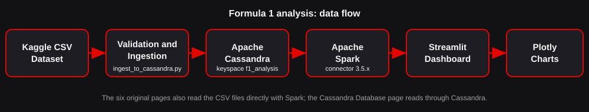

# Formula 1 Race Performance Analysis — Apache Spark + Apache Cassandra

A dark-themed **Streamlit + Plotly** dashboard whose analytics run on **PySpark 3.5.3**, now using the real
Kaggle Formula 1 CSV files and a genuine **Apache Cassandra** database (`keyspace f1_analysis`) that Spark reads through the
**Spark Cassandra Connector**.

> **Dataset provenance (not verified):** the supplied ZIP contains only 14 CSV files, no README or licence file.
> The dataset's title, author, source URL and licence therefore **cannot be verified from the files** and are not claimed.
> The dashboard says "based on the supplied historical Formula 1 CSV dataset (1950–2026)".

## 1. What changed compared with the original project

| Original | Now |
|---|---|
| 6 tiny synthetic CSVs | the 14 real CSV files in `data/` (29 MB, ~885 k lap rows) |
| 6 pages | the same 6 pages (improved) **+ page 7 "Cassandra Database"** |
| Spark reads CSV only | Spark reads CSV (pages 1–6) **and Cassandra** (page 7) |
| — | `docker-compose.yml`, `cql/schema.cql`, `create_schema.py`, `ingest_to_cassandra.py`, `.env.example` |

Details are in [docs/CHANGES.md](docs/CHANGES.md).

## 2. Architecture



```text
Kaggle CSV Dataset → Data Validation and Ingestion → Apache Cassandra → Apache Spark → Streamlit Dashboard → Plotly Visualisations
   data/*.csv        data_loader.py +                f1_analysis        cassandra_spark.py   app.py +          visualizations.py
                     ingest_to_cassandra.py          (14 tables)        spark_processor.py   cassandra_page.py
```

* Pages 1–6 read the CSV files with Spark (fast, no database needed).
* Page 7 reads the **Cassandra tables** with Spark and shows connection status, tables, record counts, previews,
  ingestion status and three Spark analyses computed **only from Cassandra data**, plus a control check against the CSV pipeline.
* If Cassandra or the connector is unavailable, pages 1–6 still work and page 7 explains what is missing.

## 3. Folder structure

```text
formula1-spark-cassandra/
├── app.py                    Streamlit app: pages 1-6 and navigation
├── cassandra_page.py         Page 7 "Cassandra Database"
├── spark_processor.py        Spark session (+connector), cleaning, joins, aggregations (CSV and Cassandra frames)
├── cassandra_spark.py        Spark <-> Cassandra: reading tables, analyses, control check
├── cassandra_db.py           Python driver: connection test, schema, previews, counts
├── cassandra_schema.py       Data model (single source of truth) + CQL generator
├── cql/schema.cql            Generated keyspace + tables (run by create_schema.py or cqlsh)
├── create_schema.py          Creates keyspace/tables (idempotent)
├── ingest_to_cassandra.py    CSV -> Cassandra (repeatable, no truncation)
├── data_loader.py            Verified CSV schemas, validation report, Spark CSV loading
├── config.py                 Settings from environment / .env (no secrets in code)
├── visualizations.py         Plotly figures
├── docker-compose.yml        Cassandra 4.1 container
├── .env.example              Configuration template
├── requirements.txt
├── data/                     the 14 supplied CSV files (unchanged)
├── docs/                     architecture.svg, VIVA_QA.md, CHANGES.md
└── tests/                    offline tests, Spark tests, optional live-Cassandra tests
```

## 4. The dataset (checked against the real files)

| File | Rows | Used for |
|---|---:|---|
| races.csv | 1,172 | calendar 1950–2026 (6 future 2026 races have no results yet) |
| results.csv | 27,612 | race results (core of most analyses) |
| drivers.csv / constructors.csv / circuits.csv | 865 / 214 / 78 | master data |
| lap_times.csv | 885,381 | lap analysis (1,979 rows repeat an earlier key) |
| pit_stops.csv | 22,802 | pit analysis (1994–2026) |
| qualifying.csv | 11,342 | qualifying vs race |
| driver_standings.csv / constructor_standings.csv | 35,741 / 13,818 | season champions, standings |
| seasons.csv / status.csv | 77 / 141 | lookups |
| constructor_results.csv / sprint_results.csv | 13,052 / 612 | present, **not used** by the dashboard and not loaded into Cassandra |

Findings that shaped the code:

* Missing values are the literal text `\N` → read as null.
* `pit_stops.duration` is **text** (`23.4` or `1:09.764` for 813 rows), so the numeric `milliseconds` column is used.
* 646 pit stops last more than 120 s (red flags, repairs). They are kept and counted, but excluded from duration averages (`PIT_MAX_SEC`).
* `lap_times.csv` has 1,979 duplicate `(raceId, driverId, lap)` keys; the first row is kept (both in Spark and in Cassandra ingestion).
* 3 pit-stop rows have no timing and are dropped; every result row has a valid driver, constructor and race.
* Classified finish = has a finishing position **and** `statusId ≠ 2` (disqualified). Wins/podiums/average finish use classified results only.
* **Spark's CSV reader maps columns by position**, so the schemas in `data_loader.py` list every column in file order. `validate_dataset()` re-checks all 14 headers (they all match) and is shown on the Overview page.

## 5. Cassandra data model

Cassandra has no joins: **each table answers one query**, and relationships are kept as identifiers that Spark joins later.

| Table | Partition key | Clustering | Purpose / query |
|---|---|---|---|
| `drivers`, `constructors`, `circuits`, `seasons`, `status` | id (or `year`) | – | master data and lookups |
| `races` | `race_id` | – | one race by id |
| `races_by_season` | `year` | `round` | all races of a season in order (denormalised copy) |
| `results_by_race` | `race_id` | `result_id` | every result of a race |
| `results_by_driver` | `driver_id` | `race_id, result_id` | a driver's career (denormalised copy) |
| `lap_times_by_race_driver` | `(race_id, driver_id)` | `lap` | one driver's laps in one race, in order |
| `pit_stops_by_race` | `race_id` | `driver_id, stop` | all pit stops of a race |
| `qualifying_by_race` | `race_id` | `qualify_id` | qualifying session of a race |
| `driver_standings_by_race`, `constructor_standings_by_race` | `race_id` | `driver_id` / `constructor_id` | standings after a race |
| `ingestion_log` | `table_name` | – | what the ingestion script really loaded, when, and how many rows were skipped |

`cql/schema.cql` is generated from `cassandra_schema.py` (`python cassandra_schema.py --write`); a test makes sure they never drift apart.
Replication is `SimpleStrategy`, factor 1 — **development only**.

## 6. Compatibility (read before installing)

| Component | Version used | Notes |
|---|---|---|
| Python | **3.11** | as in the original project |
| Java | **17** (JDK, e.g. Eclipse Temurin 17) | Spark 3.5 supports 8/11/17; run `java -version` |
| PySpark / Spark | **3.5.3** | built for **Scala 2.12** (PySpark bundles Spark, you do not install Scala separately) |
| Spark Cassandra Connector | **`com.datastax.spark:spark-cassandra-connector_2.12:3.5.1`** | connector line 3.5.x ↔ Spark 3.5.x; `_2.12` ↔ Scala 2.12. Downloaded from Maven Central the first time Spark starts (internet needed once) |
| Cassandra server | **4.1** (Docker image `cassandra:4.1`) | 5.0 not tested |
| Python driver | `cassandra-driver` 3.29.x | |

**Windows:** Apache Cassandra 4.x has no supported native Windows build. Run it in **Docker Desktop (WSL 2)** as below
(or inside WSL 2 directly). Do not try to run Cassandra with `cassandra.bat`.

If you change the PySpark version, you must change the connector package too (set `SPARK_CASSANDRA_CONNECTOR_PACKAGE` in `.env`) —
check <https://mvnrepository.com/artifact/com.datastax.spark/spark-cassandra-connector_2.12> for the matching version.
I could not reach Maven Central from my build environment, so the exact artifact `3.5.1` is **unverified here**; Spark prints a clear
download error on first start if it does not exist.

## 7. Setup on Windows (step by step)

Install once: **Python 3.11**, **Java 17**, **Docker Desktop** (enable the WSL 2 backend, start it, wait until it says "running").

```powershell
# 0. open PowerShell in the unzipped project folder
java -version                       # should say 17
py -3.11 --version

# 1. virtual environment + packages
py -3.11 -m venv .venv
.\.venv\Scripts\Activate.ps1        # if blocked: Set-ExecutionPolicy -Scope Process Bypass
python -m pip install --upgrade pip
pip install -r requirements.txt

# 2. (optional) configuration - the defaults already match docker-compose.yml
copy .env.example .env

# 3. start Cassandra and wait until STATUS shows "healthy" (1-2 minutes)
docker compose up -d
docker compose ps

# 4. create keyspace f1_analysis and the tables (safe to repeat)
python create_schema.py

# 5. check the CSV files without touching Cassandra (optional)
python ingest_to_cassandra.py --dry-run

# 6. load the data (safe to repeat; lap times take a few minutes)
python ingest_to_cassandra.py

# 7. start the dashboard (first start downloads the Spark Cassandra Connector)
streamlit run app.py
```

Useful variants: `python ingest_to_cassandra.py --tables drivers races results_by_race`, `--limit 1000` (quick test),
`--create-schema` (run the schema first). Open the keyspace manually:
`docker exec -it f1-cassandra cqlsh -e "DESCRIBE KEYSPACE f1_analysis"`.

Stop everything: `docker compose down` (data stays). `docker compose down -v` **deletes** the stored data.

## 8. How Spark connects to Cassandra

`spark_processor.get_spark()` builds the session with
`spark.jars.packages = <connector>`, `spark.cassandra.connection.host/port` (and username/password only if set in the environment).
`cassandra_spark.read_table()` then loads a table with
`spark.read.format("org.apache.spark.sql.cassandra").options(table=..., keyspace="f1_analysis").load()`,
restores the CSV-style column names, and the **same** `clean_data → join_results → driver_stats / season_points / pit_by_season`
functions as the CSV pipeline run on those DataFrames. Spark performs the joins that Cassandra cannot.

If Spark cannot start with the connector (no internet, wrong Java), it starts **without** it, pages 1–6 keep working, and
page 7 shows the reason. Offline machine: download the connector *assembly* JAR and set `SPARK_CASSANDRA_CONNECTOR_JAR`.

## 9. The seven pages

1. **Overview** – totals (races with results, drivers, constructors, circuits, seasons), fastest lap, most successful driver/constructor, wins, points per season, **season champions**, race winners, and a dataset-validation table.
2. **Driver Performance** – filters; wins, podiums, points, average finish, lap statistics; finishing-position lines (1–8 drivers); **qualifying vs race**.
3. **Constructor Analysis** – points, wins, podiums, driver contributions, season comparison.
4. **Lap Time Analysis** – per-race pace chart, summary, slow-lap detection (mean + 2 std per driver and race).
5. **Pit Stop Analysis** – stops and durations per driver, **duration by season**, pit time vs finishing position.
6. **Spark Analytics** – Spark status, schemas, DataFrame operations, four Spark SQL queries.
7. **Cassandra Database** – live connection test, keyspace, tables with purpose/keys, record counts, previews, ingestion log and a button to run the ingestion, three Spark-on-Cassandra analyses, control check CSV vs Cassandra, **Refresh** button (results are cached with a time-to-live).

Charts with hundreds of drivers/constructors show the top N (others are grouped as "Other"); tables always contain everything.

## 10. Tests and what has actually been verified

```powershell
python -m pytest tests -v                                   # offline + Spark tests (live-Cassandra tests are skipped)
$env:F1_RUN_CASSANDRA_TESTS="1"; python -m pytest tests/test_cassandra_integration.py -v   # needs Cassandra + ingested data
```

| Check | Status in my build environment |
|---|---|
| Python syntax / static lint of every module | ✅ passed |
| `tests/test_cassandra_logic.py` (11 tests: schema ↔ CQL file ↔ real CSV headers, row conversion, de-duplication, CSV validation on all 14 files, config) | ✅ 11 passed (run with a small stand-in runner because `pytest` could not be installed there) |
| Ingestion `--dry-run` over the real CSVs | ✅ all 14 tables validate; skipped rows exactly as listed in section 4 |
| `tests/test_spark_processor.py` (PySpark; includes a comparison of Spark results with pandas on the real data) | ❌ **not run** – PySpark could not be installed (no PyPI/Maven access) |
| Streamlit pages 1–7 | ❌ **not run** – Streamlit could not be installed |
| Cassandra schema creation and ingestion | ❌ **not run** – no Cassandra / Docker in that environment |
| Spark → Cassandra reads | ❌ **not run** – needs the items above |

**So the Spark, Streamlit and Cassandra parts have been written and statically checked but not executed.**
Please run the commands above on your PC; the expected outcome is that `pytest` passes, page 7 shows "Connected ✅", and the control-check
table on page 7 shows `match = yes` for all four metrics. If something fails, the dashboard shows an explanatory message; send me the message.

## 11. Sample analytical questions and results

Computed with **pandas directly from the CSV files** (independent of Spark/Cassandra). `tests/test_spark_processor.py` asserts that Spark gives
the same answers; the Cassandra page's control check compares the Cassandra route with the CSV route.

| Question | Result |
|---|---|
| Most wins (classified, position 1)? | Lewis Hamilton 106 · Michael Schumacher 91 · Max Verstappen 73 · Sebastian Vettel 53 · Alain Prost 51 |
| Most podiums? | Hamilton 208 · Schumacher 155 · Verstappen 136 |
| Constructors with most wins? | Ferrari 251 · McLaren 201 · Mercedes 142 |
| Constructors with most career points? | Ferrari 11,834.3 · Mercedes 8,667.6 · Red Bull 8,395.0 |
| Races with results / result rows | 1,166 / 27,612 (total points 57,328.05; 1,169 win rows: three early races — 1951 French, 1956 Argentine, 1957 British GP — had shared-drive winners) |
| Lap rows after de-duplication | 883,402 (885,381 − 1,979) |
| Average pit stop (≤120 s), 2024 / 2025 / 2026 | 25.05 s / 23.39 s / 25.72 s (2026 season incomplete) |

## 12. Troubleshooting

| Symptom | Fix |
|---|---|
| `JAVA_GATEWAY_EXITED`, "Java not found" | Install JDK 17; `java -version`; set `JAVA_HOME` (`$env:JAVA_HOME="C:\Program Files\Eclipse Adoptium\jdk-17.x"`). |
| `UnsupportedClassVersionError`, `InaccessibleObjectException` | Wrong Java version → use 17. |
| Page 7: "Spark could not start with the Cassandra connector" | First start needs internet (Maven Central) or `SPARK_CASSANDRA_CONNECTOR_JAR`; check proxy/VPN; delete `%USERPROFILE%\.ivy2` if a download was interrupted; see the exact message. |
| `Failed to find data source: org.apache.spark.sql.cassandra` | Spark was started without the connector (message above or `SPARK_CASSANDRA_ENABLED=false`). Restart Streamlit after fixing. |
| `NoSuchMethodError` / `incompatible` | Spark, Scala and connector versions disagree → Spark 3.5.3 + `_2.12:3.5.x` only. |
| "Cannot reach Cassandra at 127.0.0.1:9042" | `docker compose ps` must show *healthy*; Docker Desktop must be running; port 9042 free. |
| "Keyspace or table not found" | `python create_schema.py`, then `python ingest_to_cassandra.py`. |
| `ReadTimeout`/`OperationTimedOut` | Cassandra is still starting, or the machine is short of RAM (give Docker ≥ 4 GB). |
| `pip install cassandra-driver` fails to build | Use Python 3.11 64-bit (wheels exist); upgrade pip. |
| Python worker crashed / `numpy` errors | Use the activated `.venv`; keep `numpy==1.26.4`. |
| `winutils.exe` / HADOOP_HOME warnings | Harmless for these jobs. |
| Changed a CSV or the database | Sidebar **Reload data** (CSV pages) and **Refresh Cassandra data** (page 7). |

## 13. Known limitations

* Spark, Streamlit and Cassandra code paths were not executed in my environment (section 10).
* Single-node Cassandra with replication factor 1 and no authentication by default: fine for coursework, not for production.
* `constructor_results.csv` and `sprint_results.csv` are not used. Standings for the running 2026 season are provisional.
* Duplicate lap keys keep the first row (1,707 of the 1,979 repeated rows are exact copies; the other 272 differ in content, so which one is correct is unknown).
* Pit stops longer than 120 s are excluded from averages by design.
* Running the ingestion from the dashboard blocks the page until it finishes; use the terminal for the lap-times table.
* Connector version `3.5.1` and Cassandra `4.1` compatibility are taken from the connector's documented version scheme, not tested here.

## 14. Viva questions

See [docs/VIVA_QA.md](docs/VIVA_QA.md) (Spark, RDD vs DataFrame, Cassandra, keyspace, partition key, clustering column, PySpark, distributed processing, and how this project combines Spark and Cassandra).
